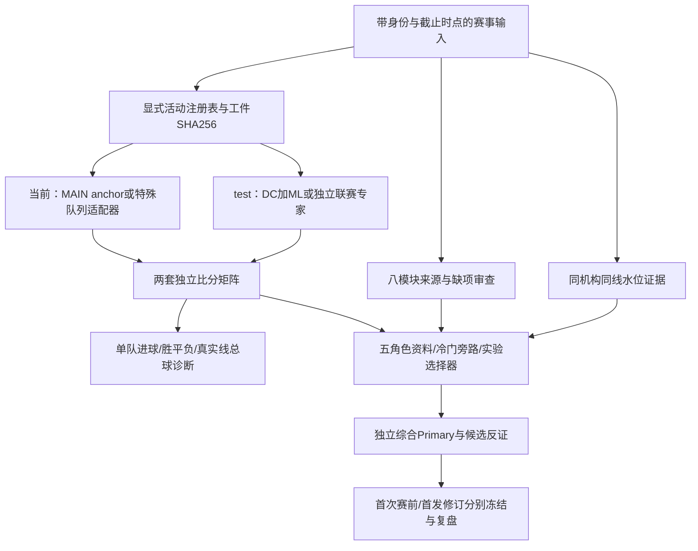

# V2 Test：分阶段模型升级

2026-11-02继续：已实际拟合[澳超动态融合与温度校准回溯候选](v2-ensemble-experiment.md)，182/62/67按日期分段，动态/校准Top1均7/67，Poisson基准8/67，未晋级。此为已用开发数据诊断，不是新的前瞻验证；球员影响模型仍缺合格关联训练表。

2026-11-02阶段二追加：已实现[来源与时点准入入口](v2-data-contract.md)，实际导入43份响应、128条合格观测、11份保守隔离，并生成7场未来特征快照。这里只完成数据基础，不代表动态融合/球员影响/新校准已训练或本路线全部完成。

2026-11-02按用户提供的完整方案执行，独立分支v2-test/audit-20261102。保留MAIN-1.2与ML-0.1作对照，不直接重写、改权重或将研究候选晋级。

## 真实执行架构

当前特殊队列包括MAIN1.1诊断兼容适配、systematic候选、澳超专家、通用泊松；不是21个队列共享一个DC/ML公式。旧weighted工件保存的五专家权重不等于当前anchor实际运行权重。v4兼容适配器在内存中声明版本/代码兼容边界，不改源工件；V2须单独记录并验证这一边界。

ML现已采用log(rate)残差修正及DC联合分布，因此方案的“ML修正lambda”已有实现基础，不应重新命名后声称新增能力。现有alpha由开发选择段选定，不能将保存的alpha或训练完成称为验证有效。

## 阶段一：审计与统一评价（本轮）

runtime/v2_test/audit.py只读检查每个实际注册路由、工件hash、history时间/重复/缺失、xG和过程训练覆盖声明、融合系数与原acceptance，并对统一库执行保留SQL的质量检查。结果存私有运行报告，不将原始数据库或API响应写公开源码。

runtime/v2_test/evaluation.py统一Top1/3/5、精确比分Log Loss和Brier、胜平负Brier/RPS/准确率、校准分箱、尾部事件Brier及预登记0.5阈值召回、Primary同子集净增命中和覆盖率、可用市场基准同场Brier。缺市场时保留market_paired_n=0，不制造市场基准。真实线大小球沿用现有五类结算，分别统计分母；来源不合格的历史输出不能直接当样本外输入。

此轮完成结构/数据质量审计和评价工具，不包括新的全量滚动回测，不等于历史泄漏已清除。实际推理验收覆盖英超一路，其他队列本轮检查hash/结构与已有测试，不冒称全部真实未来推理已执行。

## 后续阶段与准入条件

1. 数据修复：建立按提供方、赛事ID、赛季、窗口、known_at/observed_at区分的xG/xGA/npxG与球员出场资料；不存在的历史first-known时间不得用赛日或当前抓取时间填造。缺真实早期快照的数据只作回溯研究，未来独立快照验证。
2. 独立专家：各联赛分别补球队动态实力、球员影响和市场概率。预计阵容采用概率情景与覆盖信息，降低缺真实首发的依赖；球员系数需控制对手/主客/时间等混杂，不手动扣0.2球。市场只用预测时点可获得报价，去水方式明确，亚洲盘半赢/走盘不能当二分类直接归一化冒充真实概率。
3. 融合/选择：在时间推进的样本外基础预测上训练门控器，门控器、校准器、选择器均用嵌套时间隔离；最近表现只能包含当时已结算比赛，数据质量不等于预测置信度。不从同一最终留出反复选模型。逐项消融，动态融合与固定alpha比较；独立Primary与概率Top1比较净增命中及覆盖率，不把提高概率质量等同提高Primary。
4. 场景/尾部：比较主/客先领先、僵持、强队领先扩大、轮换等条件；不得把未来赛中状态当赛前事实。校验单队3+/4+、总球4+/5+；不为大比分统一加球。基础分钟模拟与已拟合状态模型分开。
5. 复盘/晋级：复用已冻结真实台账，按联赛、版本、阶段、赔率区间分层，报告完整样本量与不确定性。只有同场同节点的未见验证和消融支持，才按现有授权切换或回滚；旧工件/预测永久保留。

## 目标口径

Primary精确比分仍是业务主指标；Log Loss、Brier和校准是最高优先的概率质量诊断与晋级约束，不能互相冒充。70%精确比分不作为全量足球普遍可实现承诺；保留历史目标记录，同时分开报告全量Top1、预先筛选子集Top1及覆盖率、Top3/5和校准。禁止通过事后筛选、只报高置信子集或换分母“达标”。胜平负和实际线大小球继续独立评价。

本分支验证：362项测试执行，无失败；1组私有历史集成检查因缺文件跳过。完整统一模块主链已另用真实活动工件运行，矩阵保持一致。审计工具只读数据库；本次未跑新的滚动绩效回测。
