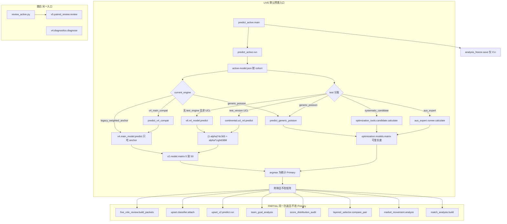

# Phase 1 架构与数据审计（真实执行路径）

审计时间：2026-11-02 18:00（北京时间）。范围：从默认预测入口顺着源码走到比分 / 胜平负 / 实际盘口大小球，再看到赛后复盘。对照提案是 Boss 2026-11-02 V2.0 方向。本文件不改生产权重。

证据边界：本机没有 `/workspace/WCPP`，也读不到私有数据仓库。活动工件的 `alpha`、`feature_xg_match_count` 和逐队样本量不在 Git 身份清单的允许字段里（`scripts/version_checkpoint.py` 只摘版本、截止日和 `fit_n`）。下文凡写「清单记载」均指 2026-10-29 `WCPP-DUAL-5` 快照 `manifests/runtime-assets-20261029-queue-supplement.json`（注册表 SHA256 `7c53ac2f7b3b5c856beb6590c274b006f2cdc8d4c49625fe6beef16b2e9a1590`）。凡写「源码」均可在本仓库复核。`runtime/research/phase1_callgraph.py` 用语法树核对下文标成入口调用的符号仍在对应函数里。

## 1. 默认入口（LIVE）

```text
python runtime/predict_active.py FIXTURE.json \
  --registry /workspace/WCPP/runtime/active-model.json \
  --out NEW.json [--freeze-root ...] [--stage prematch|live]
```

`run()`（`runtime/predict_active.py`）读取注册表 `models[fixture['cohort']]`，校验工件 SHA256，然后并行产出当前模型和 test 模型。选择政策写死为 `INDEPENDENT_PAIRED_RESEARCH_NO_BEST_OF_TWO`：两套矩阵都保留，程序不挑更高命中的一边当唯一推荐。

CLI 在 `run()` 之后调用 `research.analysis_freeze.save`。`run()` 本身不冻结。`--stage live` 进不到滚球数值：各引擎要求 `cutoff < kickoff` 且 `kickoff > now`（`predict_active.py` 不单独放宽；`v4/main_model.py` `predict`、`v6/ml_model.py` `predict`、`active_route_engines._prematch_clock`）。开赛后再跑默认入口会在出矩阵前失败。冻结函数自己允许 `stage=live`，但默认 CLI 先调用 `run()`。

`runtime/v4/cli.py`、`runtime/wcpp.py`、`models/main-v1/registry.json`（入口仍写 `runtime/v4/cli.py`，版本 `WCPP-MAIN-1.0`）不是 README 规定的默认入口。`docs/project-state.md` 里的 TFA / MPF / Selector 4.1 / Four-State / 动态 λ 链是目标描述，默认 `run()` 没有这些调用。

## 2. 活路径调用图



`phase1_callgraph.py` 核对：`run` 调用 `legacy.predict`、`predict_v4_compat`、`predict_generic_poisson`、`predict_systematic_candidate`、`predict_aus_expert`、`ml_predict`、`align_matrix_support`、`build_packets`、`upset_attach`、`candidate_run`、`attach_goals`、`attach_audit`、`compare_pair`、`analyze_market`、`build_match_analysis`。`run` 源码中没有 `egidi`、`shin_probabilities`、`minute_simulator`、`learn_weights`、`pooled_matrix`、`train_context`、`shadow`。

当前模型若 `current_engine=legacy_weighted_anchor`，执行的是 `legacy.predict(artifact['anchor'])`（`predict_active.py` 约 51–54 行），不是 `v5.weighted_model.predict`。学习到的五专家权重留在工件里，不进入当前矩阵。test 轨在这些队列上另有 ML 工件，因此也不会落到 `weighted_model.predict(..., variant='test')`（那条只在没有 `test_artifact_path` 时使用，约 108–112 行）。

## 3. 固定融合比与分联赛覆盖

活的数值融合只有 test 轨 ML / UCL：

```text
m = (1 - alpha) * dc365 + alpha * LightGBM 残差矩阵
```

位置：`runtime/v6/ml_model.py` `predict`。`continental/ucl_ml.py` 是同一公式的欧冠拷贝。`CONFIG['blend_candidates']` 为 `0.25, 0.5, 0.75, 1.0`。`alpha` 在校准窗上按 Top1 优先、其次更低的 `score_log_loss` 选取（`train`，测试折不参与挑选）。没有单独的联赛覆盖表。联赛差异就是该 cohort 工件里的 `alpha` 字段。

因此「DC 25% + ML 75%」只在某个工件的 `alpha == 0.75` 时成立。本环境打不开这些 JSON，不能把 75/25 写成已经核对过的现行数字。刷新脚本 `runtime/research/fixed_recipe_refresh.py` `ml_refit` 明确复制原 `alpha`、禁止重选。

其他混合，都不在默认当前 Primary 上：

| 机制 | 状态 | 证据 |
|---|---|---|
| 五专家单纯形 `learn_weights` / `pooled_matrix` | DEAD（相对默认当前输出） | `v5/weighted_model.py`；`run` 不调用 |
| `blend180` = 0.5 短期强度 + 0.5 基线 | DEAD（除非 `execution_recipe` 被设成它） | `v4/main_model.py` `distribution`。加权锚训练把 anchor 写成 `execution_recipe=baseline` |
| 澳超 ML 残差系数 0.35 | 仅 aus test，且取决于工件 `configuration` | `aus_expert/runner.py` `matrices`：`alpha=.35 if cfg=='ml'` |
| 系统候选 `cfg['alpha']` 0.25 或 0.5 | 仅 jpn.1 / kor.1 test | `optimization/pipeline.py` `GRID`；`candidate.calculate` |
| Egidi 的 `w_1x2/w_ou/w_cs` 与 Shin | DEAD（研究脚本） | `runtime/research/egidi_blend/`，未接入 `run` |
| 上下文系数改 λ | PARTIAL 门控 | `v4/context_learning.py` `adjusted_rates`：无 `validated` 系数则原样返回。锚训练写 `context_coefficients=None` |

`market_numeric_applied` / `market_numeric_adjustment_applied` 在 MAIN 与 ML 预测字典里为 false（`ml_model.py` `predict`，`main_model.py` `predict`）。

## 4. 逐队列路由（清单 + 源码分发）

竞彩不是模型引擎。身份来自赛程采集（`docs/api-first-collection.md` 的 `types=jingcailottery`）和人工核验。预测键是 `fixture['cohort']`。未登记队列直接 `ValueError`。2026-10-29 竞彩说明：芬超争冠组因无阶段标签被挡住；意甲/瑞典/英联杯/巴甲/亚冠二级走下表对应队列（`docs/jingcai-model-coverage-20261029.md`）。

清单显示名 `WCPP-ML-0.1` 不是合法的 `test_engine`。`predict_active.py` 只接受显式引擎 `systematic_candidate`、`aus_expert`、`generic_poisson`。该字符串若写进 `test_engine` 会抛 `unknown test route engine`。它只能是 `test_version`（或缺失 `test_engine` 时的回退标签），执行函数是 `v6.ml_model.predict`。`WCPP-ML-UCL-0.1` 同理，走 `test_version` 分支 `continental.ucl_ml.predict`。

| cohort | 当前引擎 | 当前工件版本 / 截止 | test 执行 | test 版本 / 截止 | 备注 |
|---|---|---|---|---|---|
| eng.1 esp.1 ger.1 ita.1 fra.1 por.1 ned.1 bra.1 swe.1 nor.1 ksa.1 usa.1 mex.1:apertura:regular eng.2 | `legacy_weighted_anchor` | `WCPP-WEIGHTED-0.1`，截止见清单（约 2026-09-20 至 2026-10-09） | `v6.ml_model.predict` | `WCPP-ML-0.1`，同截止日 | 欧洲训练允许 eng/esp/ger/ita/fra。usa.1 另被 `league_tracks.py` 标成 OOD，禁止并进欧洲训练集，但有自己的活动工件 |
| uefa.champions:NEW_FORMAT:league_phase | 同上 | 截止 2026-09-10 | `ucl_ml.predict` | `WCPP-ML-UCL-0.1` | 独立历史，不借五大联赛 ML |
| jpn.1 | `v4_main_compat` | `WCPP-MAIN-1.1` | `candidate.calculate` | `WCPP-SYSTEMATIC-RESEARCH-0.1`，`fit_n=1152`，`fit_end=2026-10-10` | OOD。适配器声明数值路径相对 1.1 不变 |
| kor.1 | `v4_main_compat` | `WCPP-MAIN-1.1` | 同上 | `fit_n=777`，`fit_end=2026-10-09` | OOD。`kor.2` 2026 年后赛制在候选里被拒绝，且不在这 21 条里 |
| aus.1 | `generic_poisson` 常数 λ | `WCPP-AUS-CURRENT-CONSTANT-0.1`，`fit_n=2807`，截止 2026-04-26 | `aus_expert.runner.calculate` | `WCPP-AUS-EXPERT-0.1.1-DATAFIX`，同样本截止 | 预测时 `History(..., facts=[])`，返回 `xg_status=MISSING_NOT_TRAINED` |
| afc.champions:ELITE:league_phase | 常数 λ | `fit_n=207`，截止 2026-10-12 | 球队 Poisson | 同样本 | 不覆盖淘汰赛或亚冠二级 |
| afc.cup:CHAMPIONS_TWO:group_stage | 常数 λ | `fit_n=197`，截止 2026-09-17 | 球队 Poisson | 同 | 竞彩申花场走这里，不借精英联赛相 |
| eng.league_cup:single_leg | 常数 λ | `fit_n=342`，截止 2026-10-28 | 球队 Poisson | 同 | 不借英超 |

`runtime/league_tracks.py`：`aus.1`、`jpn.1`、`kor.1`、`usa.1` 不得进入欧洲训练列表，也不得 `promoted=True`。这是训练隔离，不是「这些联赛没有活动路由」。

仓库内 `models/main-v1/*.json` 是更早的 MAIN 研究件（英超执行配方 `baseline`，测试折 474 场 Top1 57/474）。它们的哈希不是清单里的 `WCPP-WEIGHTED-0.1` 路径。不要把 57/474 当成现行双模型成绩。

## 5. 数据 → 特征 → 概率

### 5.1 当前模型（MAIN-1.2 数值核）

`v4/main_model.py` `predict` → `distribution(core, form, history, fixture, execution_recipe)` → `v2/model.py` `rates` + `matrix`。

基线配方用收缩后的同队进球率（`fit_baseline`），独立泊松，Dixon–Coles 不乘。`dc365` 才使用 `fit_nuisance` 的 ρ，并且只改 `(0,0)(0,1)(1,0)(1,1)` 四格。ρ 的搜索边界是 `(-0.08, 0.006)`（`v2/model.py` `fit_nuisance`）。矩阵 `CAP=50`，格点 0..50；归一化前质量偏离 1 超过 `1e-9` 就拒绝，没有单独的 8+ 桶。

温度校准函数 `calibrate` 只被 `runtime/v2/benchmark.py` 调用。活的 `distribution` 使用默认 `temperature=1`。

上下文数值：`adjusted_rates` 在系数未验证或证据不是完整 L1 时不改 λ。战意、阵容、赛程特征定义在 `runtime/v3/context.py` `assess`，要进系数训练还必须有至少 200 条真实冻结样本（`context_learning.train_context`）。`run` 不调用 `train_context`。`decision_audit.assess_decision` 只做覆盖审计，`numerical_fusion_validated=False`。

盘口：`quote_check` 校验实际大小球盘口、博彩公司和查询时间不晚于 cutoff。方向是模型矩阵在该盘口上的全赢/半赢/走/半输/全输结算值比较，不是去水后的市场概率，也不是赔率特征（`main_model.py` `predict` 里 `direction_basis`）。

### 5.2 test ML-0.1

先验历史严格 `date < 比赛日`（`feature_matrix`）。不足 60 场拒绝。侧向特征：近 6 场进失球、积分、90 天、主客场、间隔、BTTS、大于 2.5、xG/xGA、射正、射偏、控球，以及覆盖率。缺失 xG 变成 NaN，不是 0（`side_features`）。

LightGBM 泊松残差，`init_score=log(dc 速率)`，残差裁剪到 ±0.4，λ 裁剪到 `[0.05, 12]`，再铺成 Dixon–Coles 矩阵，然后与未调整的 `dc365` 按 `alpha` 相加。Primary 是融合矩阵的 `argmax`（行优先，平手留在更小的主队进球索引）。胜平负是矩阵下三角 / 对角线 / 上三角之和。大小球复用当前模型已经核对过的同一条盘口，只重算结算。

`context_numeric_applied=False`，`market_numeric_applied=False`。限制条文写明没有阵容、伤停、战意、诚信或市场系数。

### 5.3 日职 / 韩 K 的系统候选

`optimization/models.py`：岭正则球队泊松，可选 LightGBM 残差。特征列在 `optimization/features.py`：`understat_xg` 等在 `GROUPS['xg']`。残差组不是 `xg` 时，`candidate.finalize` 把 `trained_xg_channel` 设为 false，状态为 `DISABLED_IN_SELECTED_CONFIGURATION`。清单里的 jpn/kor 工件只有约 4KB / 3KB，选择组写在工件内，本环境未打开，不能声称这两条已经用了 xG 树。伤停字段在 `calculate` 返回里固定为 `NOT_TRAINED_NO_ASOF_HISTORY`。矩阵长度随 λ 变化（至少 16），不是 51。`align_matrix_support` 只用 0 填充把两边补成同样形状，不增加尾部概率。

### 5.4 澳超

当前模型是两队常数进球率的独立泊松。test 的 `calculate` 每次用空 facts 构造 `History`，因此 Understat/过程列没有事实可填。协议写明 `no xG/process`。返回字段写死 `xg_status=MISSING_NOT_TRAINED`、`injuries_status=NOT_TRAINED`。

## 6. 八项核对

### 6.1 融合比例

见第 3 节。源码网格含 25/75，但是逐工件存储，不是全局常量，也没有「英超覆盖文件」。本机未读到现行 `alpha`。

### 6.2 xG 训练行是否为 0

机制：`feature_xg_match_count = sum(bool(row.get('xg_evidence')))`（`ml_model.py` `train`）。合格 xG 还要求 https 来源、查询时间不晚于该历史行的 `observed_at`，数值在 `[0, 30]`（`xg_values`）。

采集与未使用：

| 位置 | 做什么 | 是否进入活动 ML 训练行 |
|---|---|---|
| `data_sources/registry.json` | API-Football 角色含 `xg_shotmaps`；5Dollar 注明 xG 必须按真实字段检查 | 采集能力，不是训练标签 |
| `data_sources/history_process.py` `enrich` | 只回填射正、射偏、控球和 `process_evidence` | 不写 `xg_evidence` |
| `v6/train_registered.py` | 用 `enrich` 后的历史调用 `train` | 不会凭空制造 xG 行；只有原历史里已有 `xg_evidence` 才计数 |
| `v7/export_training.py` | 可从 football-data `HxG/AxG` 或一份 Dixon–Coles 仓库 CSV 写入 `xg_evidence` | 供给 `v7/continued_model.py`，`run` 不调用 |
| `optimization/features.py` | Understat xG，且 `lag_days` 默认 7 | 系统候选 / xG shadow，不是 ML-0.1 |
| `optimization_tools/xg_shadow.py` | 五大联赛固定 `M3-xg-a0.5`，要求 `xg_oof_bilateral_targets_ge3>0` | 明确 `active_switch=False` |
| `research/match_analysis.py` | 文档写工件计数为 0 与当场网页 xG 可以同时存在 | 不改矩阵 |
| 澳超 `calculate` | 预测返回值写明未训练 | 空 facts |

结论：活动 ML 的计数器只认 `xg_evidence`。登记过的再训练入口 `train_registered` 用的 enrich 不加这个字段。文档 `docs/single-match-analysis.md` 把现行工件记为 0。本次没有打开 `/workspace/WCPP/models/**/artifact.json`，所以「每个活动 ML 文件里的整数确实是 0」仍是未重新读取的工件事实，不是本环境新算出来的。不能把网页上新查到的 xG 说成这些树已经用它训练。

### 6.3 阵容 / 伤停 / 战意

数值路径：ML 限制声明无系数；系统候选与通用泊松返回未训练；澳超返回未训练；`context_learning` 的动机特征只有在已验证系数且 L1 证据齐全时才会改泊松 λ，默认锚没有系数。`research/lineup_evidence.py`、`research/availability.py` 是文本/JSON 证据提取。`five_role_review.build_packets` 状态为 `EVIDENCE_PACKET_ONLY_LLM_NOT_EXECUTED`。`evidence_agents.py` 为 `NOT_RUN_NO_CALLER`。`research/match_analysis.py` 把未公布首发做成情景比较，不写回矩阵。

结论：活的比分概率不吃阵容、伤停或战意数值。这些是人工或证据包。重大未决人员风险按项目规则保持待定，而不是模型自动降权。

### 6.4 赔率

| 用法 | 状态 |
|---|---|
| 大小球盘口结算模型概率 | LIVE，校验后使用，不作为特征 |
| `market_movement.analyze` | PARTIAL。同公司、同盘、同线的价格差；`prediction_modified=False`；不推断资金流 |
| `upset/classifier.py` `fair` | PARTIAL 侧车。`1/odds` 再归一（比例去水，不是 Shin）。缺注册表则 `ABSTAIN_NO_CLASSIFIER_REGISTRY`。`main_score_reordered=False` |
| `upset_v2.predict.run` | 同上，侧车，不改比分 |
| Egidi `shin_probabilities` | DEAD（相对 `run`）。研究回测会优先收盘赔率 |
| 比分模型相对去水市场的基线 | 默认训练指标里没有。只有冷门分类器报告 `market_baseline` |

活动比分模型没有独立市场专家，也没有把赔率放进 LightGBM。

### 6.5 高比分尾部

活 MAIN/ML 矩阵是 51×51，要求几乎所有泊松质量落在 0..50。λ 被限制在 12 以下，所以 5–0、4–3 这类比分在格内，但质量随阶乘下降，`argmax` 自然落在 λ 附近的低比分。没有负二项、没有 8+ 桶、没有尾部再加权。

`runtime/wcpp.py` `distribution` 的 8+ 三桶是旧挑战者，README 写明不是默认入口。

`score_distribution_audit.py` 会标记「联合众数总进球 ≤2 且 3 球以上质量超过一半」，`numeric_output_modified=False`，不因此改 Primary。`layered_selector.select` 另给一个方向×总进球带的实验选分，`compare_pair` 写 `primary_override=False`。

零填充对齐（`align_matrix_support`）在较短矩阵外补 0，审计字段 `tail_probability_added=0`。高比分若落在较短支持之外，补零后概率仍是 0，不会把尾部质量搬进来。

### 6.6 评价指标缺口

| 指标 | 训练诊断里有没有 | 默认赛后 `review_active` |
|---|---|---|
| 精确比分 Top1 | 有，且是 MAIN 选配方和 ML 选 alpha 的第一键 | 有，分当前/test，版本不同则禁止合并 |
| 比分 log loss | 有（`score_matrices` / `v2.model.metrics`） | 无 |
| 胜平负命中与 Brier | 训练有 | 赛后只有命中，无 Brier |
| 固定 2.5 大小球 | 训练有，并注明不是实际盘口 | 无 |
| 实际盘口五档结算 | 预测时计算 | 复盘只记档位，无概率 Brier |
| 胜平负 log loss | 仅 `v2.model.metrics`，不在 `score_matrices` | 无 |
| RPS | 无 | 无 |
| 比分或胜平负校准 / ECE | `v4/diagnostics.py` `reliability` 能算 ECE 和 Brier，默认复盘不调用 | 无 |
| 对去水市场的基线 | 比分模型无；冷门分类器有 | 无 |
| CRPS | 澳超专家评估函数有；MAIN/ML 无 | 无 |

`v4/diagnostics.diagnose` 对已保存预测能算比分 log loss、胜平负 Brier、进球残差和结算 Brier。它不是 `review_active.py`。因此「评估过于 Top1」对默认复盘成立；训练代码其实已经算了 log loss 和 Brier，但选 alpha / 选配方时 Top1 优先，log loss 只是容差或次序键。

### 6.7 分联赛

见第 4 节。没有「竞彩专用网络」。OOD 四条有活动路由，同时被禁止混进欧洲训练。

### 6.8 时间泄漏嫌疑

下列是代码上的风险点，不是已经用赛后样本证明泄漏发生。

| 嫌疑 | 位置 | 说明 |
|---|---|---|
| 交付用的 ML booster 吃进了诊断测试折的标签 | `v6/ml_model.py` `train`：`final_booster = fit_booster(first_items + calibration_items + test_items)` | 报告里的 test 指标用的是只拟合到校准末的 booster。随后又把测试标签拟合进要保存的工件。`alpha` 本身不在测试折上重选。未来场若 `train_end` 早于开球日，这不是「用了这场结果」，而是「对外声称的测试集已被最终工件见过」 |
| 加权锚的 `fit_core(rows)` 用全部日期，含原测试段 | `v5/weighted_model.py` `train` | 权重在校准窗学习；最终 core 用全历史。对真正未来场合理，但不能把该 core 的回溯说成测试折未参与拟合 |
| 系统候选最终拟合使用全部历史标签 | `optimization_tools/candidate.py` `finalize` 注释 `refit_policy` | 选择不用审计标签；部署拟合用了。与上一条同类 |
| 澳超部署拟合使用全部历史，并在注释中写明 holdout 分属于更早的拟合 | `aus_expert/runner.py` `train` | `calculate` 使用这份全历史 core |
| 历史特征没有 first-known 时刻 | `history_process.enrich` 写 `first_known_at: None`；`v7/export_training.py` 写明回顾性观测；澳超 manifest 同样 | 工件 `built_at`/`observed_at` 不得晚于预测 cutoff，但单条射门或 xG 没有「当时已公开」的时间戳。晚补的历史 xG 可以进入之后比赛的特征 |
| 日期是日历日，不是开球时刻 | `feature_matrix`：`r['date'] < kickoff 的 UTC 日期`；`main_model.predict` 拒绝历史 `train_end >= kickoff 的 UTC 日` | 同一日更早的比赛被整日排除（偏保守）。UTC 日与北京自然日相差 8 小时，接近 0 点的场次可能和来源日期错一天 |
| 无清洗间隔 | `weighted_model.chronological_split`、`v2.model.partitions` | 按独立日期分位数切，不是随机划分。边界相邻日没有 embargo |
| 盘口可以没有 `quoted_at` | `main_model.quote_check`：`quoted_at` 缺失则状态 `UNKNOWN`，只要求 `query_time <= cutoff` | 引擎不允许 cutoff ≥ 开球。若操作者把收盘价配上倒填的 query_time，检查通过。代码不会自己去拉收盘 |
| 冷门分类器同样只卡 query/quoted 相对 cutoff | `upset/classifier.py` `predict` | 比例去水用的是传入报价。侧车不改比分 |
| Egidi 加载优先收盘 1X2 / 大小球 | `research/egidi_blend/market.py` `first_complete` 收盘列 | 不在 `run` 中。若以后把该研究当特征，会把赛后或临场收盘带进训练 |
| xG shadow / Understat 用 7 天滞后，但是回顾数据 | `optimization/features.py` `History.vector` | 不在默认 ML-0.1。滞后减轻同日泄漏，不证明原始发布时间 |
| 随机 train/test | 未在 `v2`–`v6` 主训练路径发现 `train_test_split` 或 shuffle 切分 | 切分是日期顺序。不要把这一点说成没有上表那些问题 |

`predict` 拒绝 `kickoff <= now`，所以默认预测函数本身不会在开赛后把当场赔率算进矩阵。泄漏更集中在：最终工件回看了诊断测试段、特征缺少可用时间、以及人工报价时间。

## 7. 模块状态总表

| 模块 | 状态 | 证据 |
|---|---|---|
| `predict_active.run` 双模型 | LIVE | 默认入口 |
| MAIN-1.2 泊松基线（anchor / v4 适配） | LIVE | `legacy.predict`、`predict_v4_compat` |
| ML-0.1 DC+LightGBM 融合 | LIVE（test 轨） | `v6/ml_model.py` |
| UCL ML | LIVE（仅欧冠队列） | `ucl_ml.py` |
| 通用常数 / 球队泊松 | LIVE（亚冠、亚冠二级、英联杯、澳超当前） | `predict_generic_poisson` |
| 澳超专家 | LIVE（aus test） | `aus_expert/runner.py` |
| 日职/韩K 系统候选 | LIVE（这两条 test） | `candidate.calculate` |
| 五专家学习权重 | DEAD（默认输出） | 工件可含权重，`run` 不用 |
| 九类证据数值融合、上下文系数 | PARTIAL 门控，默认关 | `adjusted_rates`；`numerical_fusion_validated=False` |
| 阵容/伤停/战意数值 | DEAD（概率） / 人工证据 LIVE（报告） | 第 6.3 节 |
| 大小球盘口结算 | LIVE | `quote_check` + `total_settlement` |
| 水位变化 | PARTIAL 证据 | `market_movement.py` |
| Shin / Egidi / LambdaMART | DEAD | `research/egidi_blend/` |
| 冷门 0.1 / 0.2 | PARTIAL 侧车 | 不改 Primary；注册表在 WCPP |
| 五角色包、分层选分、比分分布审计、单队进球 | PARTIAL 诊断 | 标志写明不改分布 / 不覆盖 Primary |
| `wcpp.py` 8+ 尾部 | DEAD（默认） | 旧 README |
| Champion V21.5、Selector 4.1、Regime shadow、永久 λ | DEAD（本仓库无可执行体） | 仅字符串标记 |
| `v7` 持续训练、`xg_shadow`、分钟模拟、`score_adjustment` | DEAD（默认） | 无 `run` 引用；分钟模拟文件头写明隔离 |
| `evidence_agents` | DEAD caller | `NOT_RUN_NO_CALLER` |
| `review_active` → `paired_review` | LIVE 赛后计数 | 只记 Top1、胜平负、大小球档 |
| `diagnostics.diagnose` | PARTIAL 工具 | 有 log loss/Brier/ECE，未接到默认复盘 |
| `fixed_recipe_refresh.offline_replay` | PARTIAL 研究 | 明确是赛后重放，不写活动注册表 |

## 8. 保留 / 改造 / 删除

| 处置 | 对象 | 理由 |
|---|---|---|
| 保留为对照 | `predict_active` 双轨、MAIN 基线配方、ML-0.1 现工件与现 `alpha`、注册表哈希检查、独立复盘、OOD 禁入欧洲训练 | 在外样本证明增益前就是控制组 |
| 改造（只在 V2 Test 研究，不替换对照） | 固定 `alpha` → 动态集成；xG/球员/首发从证据包变成有 as-of 的数值通道；市场从盘口结算升级为去水基线模型；51 格尾部；Primary 与概率 Top1 分离；赛后自动复盘指标 | 对应第 9 节顺序。现行模块是接口位置，不是已训练层 |
| 不要当活模块维护 | 文档中的 V21.5 动态融合全链、未接入的 Egidi 如果没人继续实验、`evidence_agents` 空转入口、把 `wcpp.py` 8+ 桶说成现行尾部 | 它们不在默认调用图上。删除代码不是本阶段的事；阶段 1 只停止把它们写成现行生产 |

## 9. 阶段 2 建议顺序

与 Boss 优先级一致。每步都在 V2 Test 分支、独立工件、时间外样本上做，对照仍是现在的当前模型与 test 模型。

1. 本审计。调用图、活/死、泄漏点已经落在本文。未打开的工件字段（各队列 `alpha`、ML `feature_xg_match_count`）在挂载 WCPP 后做一次只读摘录即可关闭。
2. 动态集成研究。先记录现行固定 `alpha` 作为基线，再研究随联赛/不确定度变化的权重。不要在这一步改活动工件。学习权重代码（`weighted_model.py`）可以参考，但它现在不在当前输出里。
3. xG 与球员/首发数值通道。先建有 `known_at` 的库，再决定是否进入特征。禁止用 `v7` 回顾 CSV 直接晋级。伤停与战意仍须 as-of，否则继续人工情景。
4. 市场模型。与水位证据分开：去水概率、同线变价、以及相对该基线的 log loss。Shin 目前只在 Egidi 研究里。
5. 高比分尾部。在不动对照 argmax 的前提下，检查 51 格质量、低比分众数与 3+ 球质量并存的场次（审计旗标已经能列出）。
6. Primary 选择器。概率 Top1 与综合第一比分分列。`layered_selector` 已是实验元数据，默认 Primary 仍是 argmax。
7. 情景与自动复盘。把 `diagnostics.diagnose` 的 log loss、Brier、ECE、实际盘口结算接到冻结链，并保留 `paired_review` 的分版本分母。自动复盘不得回写对照权重。

建议的统一评估清单（研究用，不替代 Primary Top1 这个最高 KPI）：同一冻结时点上同时报告精确比分 Top1、比分 log loss、胜平负 log loss 与 Brier、实际盘口结算与结算 Brier、RPS 或总进球 CRPS、分箱校准（ECE）、以及去水市场基线的同样指标。分联赛、分版本，禁止赛后改分母。缺市场报价的场次单独列出，不能用固定 2.5 代替。

## 10. 复核命令

```bash
python runtime/research/phase1_callgraph.py
python -m unittest runtime/research/test_phase1_callgraph.py
```

两个命令都不读取模型工件，也不发网络请求。
